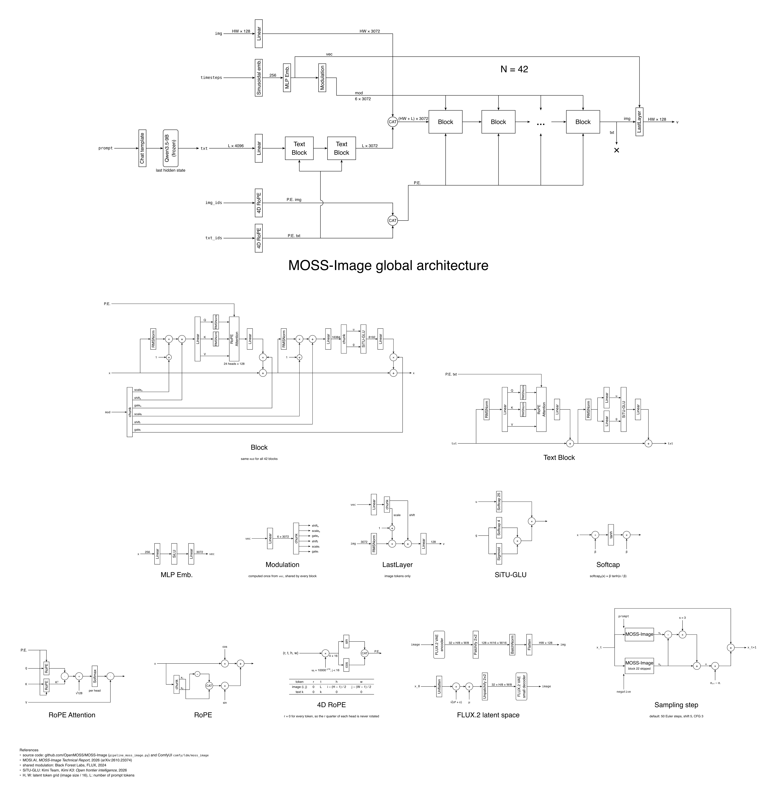

# MOSS-architecture-diagram
A detailed diagram laying out the full MOSS-Image architecture as released by OpenMOSS, broken down to single ML blocks.


(open the file to view it zoomed in, or use the [PDF](./diagram/moss_architecture_diagram.pdf))

The diagram is written in [Typst](https://typst.app) with [CeTZ](https://github.com/cetz-package/cetz), every figure has its own file in `diagram/`. To rebuild it:
```sh
typst compile diagram/moss_architecture_diagram.typ moss_architecture_diagram.png --ppi 200
```

# A few things worth noticing
- the 42 blocks are all single stream, image and text tokens are concatenated once after the text adapter (a Linear followed by two plain transformer blocks) and go through the whole stack together
- the modulation is computed once per step from `vec` and shared by all the blocks, there is no per block modulation and no SiLU before the Linear
- `vec` only depends on the timestep, there is no pooled text embedding and no guidance embedding
- the FFN is a SiTU-GLU: a SiLU-like gate where both branches are soft-capped with tanh (β = 4 on the gate, β = 25 on the value)
- RoPE has 4 axes (r, t, h, w) with 32 dims each, r is always 0 for now so that part of each head is never rotated (it is reserved for reference images)
- the default sampler skips block 22 in the negative branch of CFG, so each step is still only two forward passes

# References
- [MOSS-Image source code](https://github.com/OpenMOSS/MOSS-Image) and the `pipeline_moss_image.py` shipped with the [weights](https://huggingface.co/OpenMOSS-Team/MOSS-Image-SFT)
- [ComfyUI implementation](https://github.com/Comfy-Org/ComfyUI/tree/master/comfy/ldm/moss_image)
- [MOSI.AI, *MOSS-Image Technical Report*, 2026](https://arxiv.org/abs/2610.23374)
- Shared modulation: [Black Forest Labs, FLUX, 2024](https://github.com/black-forest-labs/flux)
- SiTU-GLU: [Kimi Team, *Kimi K3: Open frontier intelligence*, 2026](https://arxiv.org/abs/2607.24653)
- Style borrowed from my [Flux.1 architecture diagram](https://github.com/brayevalerien/Flux.1-Architecture-Diagram)
